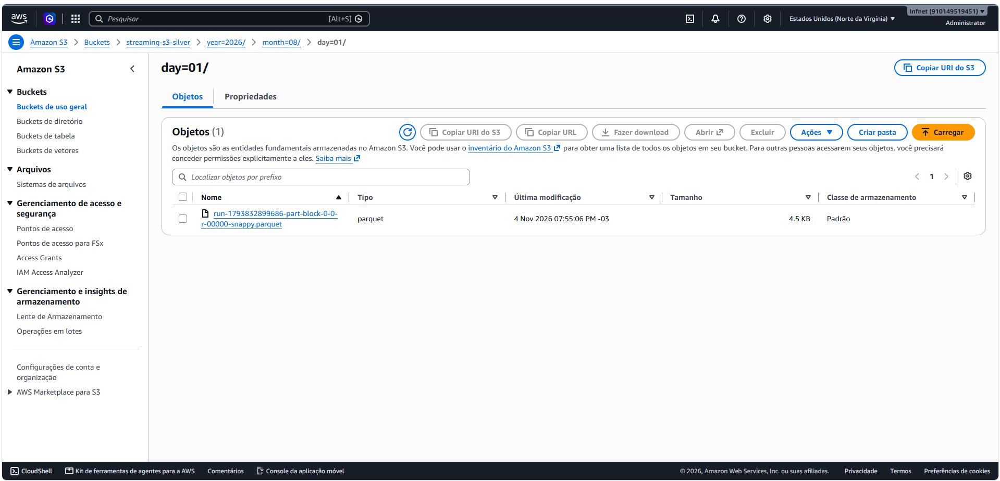
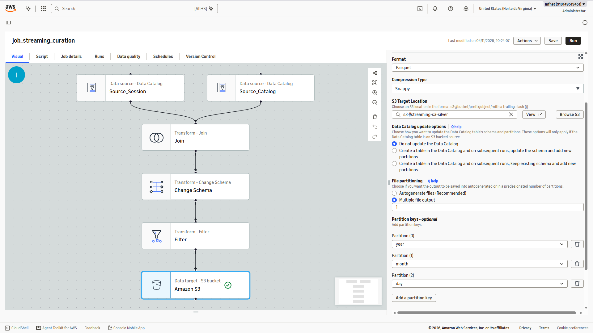

# Pipeline ETL Serverless com AWS Glue Studio

Pipeline de Engenharia de Dados construído na AWS para ingerir, cruzar e padronizar logs de reprodução e dados de catálogo de uma plataforma de streaming. A arquitetura separa o armazenamento bruto do processado no Amazon S3 (padrão *Medallion*), garantindo escalabilidade sob demanda, controle de custos de retenção e governança centralizada de metadados.

> Projeto desenvolvido como entrega da disciplina **Pipelines ETL com AWS Glue Studio** — Pós-Graduação em Engenharia de Dados (Instituto Infnet).

---

## Arquitetura e Fluxo de Dados

Em uma operação de streaming, dados de sessão e catálogo chegam em formatos distintos e sem padronização, travando análises e elevando o custo de leitura. Para resolver esse gargalo, o pipeline opera em quatro estágios desacoplados:

1. **Armazenamento em Camadas (Amazon S3):**
   - **Bronze (`streaming-s3-bronze`):** Camada de pouso imutável que recebe o cadastro de títulos em JSON Lines (`catalog/catalogo_titulos.json`) e os logs diários de reprodução particionados por data e usuário (`sessions/year=YYYY/month=MM/day=DD/*.csv`).
   - **Silver (`streaming-s3-silver`):** Camada analítica que recebe os dados limpos, tipados e consolidados no formato colunar Apache Parquet com compressão Snappy.
2. **Catalogação e Evolução de Esquema (AWS Glue Data Catalog):**
   - O rastreador `streaming-crawler` mapeia automaticamente os arquivos da camada Bronze para as tabelas `catalog` e `session` no banco `db_streaming_catalog`, aplicando *Schema Evolution* para absorver novas colunas sem quebrar consultas.
3. **Processamento Visual e Carga Incremental (AWS Glue Studio):**
   - O job `job_streaming_curation` (Apache Spark serverless) cruza sessões e catálogo via *Inner Join* na chave `title_id`, ajusta tipos no bloco *Change Schema*, retém a atualização mais recente por `session_id` (CDC), descarta cliques acidentais (`watched_seconds > 5`) e grava apenas lotes inéditos graças ao recurso *Job Bookmarks* ativado.
4. **Orquestração e Qualidade (Glue Workflow & DataBrew):**
   - O fluxo `wf_streaming_pipeline` encadeia automaticamente o crawler e o job ETL por meio de gatilhos (`trg_start_crawler` e `trg_crawler_to_etl`), enquanto o projeto `Streaming-Databrew` apoia o perfilamento estatístico e a validação exploratória das amostras.

> 📄 **Código-fonte do job PySpark:** [`src/job_streaming_curation.py`](src/job_streaming_curation.py)

---

## Decisões de Engenharia e FinOps

- **Segurança e Delegação de Acesso (IAM):** Criada a função de serviço `AWSGlueS3` assumida exclusivamente pelo AWS Glue, combinando as políticas gerenciadas `AWSGlueServiceRole` e `AmazonS3FullAccess` com bloqueio de acesso público e criptografia nativa nos buckets S3.
- **Redução de Custos de Consulta (*Partition Pruning*):** A gravação na camada Silver organiza os arquivos no particionamento temporal Hive (`year/month/day`), permitindo que motores analíticos leiam apenas os diretórios e colunas filtrados.
- **Solução para Arquivos Pequenos (*Small Files Problem*):** Configurada a consolidação de escrita (`Multiple file output = 1`) no nó de destino S3, unificando múltiplos CSVs diários de usuários em um único arquivo `.snappy.parquet` otimizado por partição.
- **Retenção Histórica Automatizada:** Aplicada a regra de ciclo de vida `hibernar_dados_silver` no bucket `streaming-s3-silver` com corte mínimo de 128 KB (`131.072 bytes`), movendo objetos antigos para `S3 Standard-IA` aos 365 dias e congelando no `S3 Glacier Deep Archive` aos 730 dias.

---

## Evidências de Execução

| Etapa | Recurso AWS | Evidência Visual |
| :--- | :--- | :--- |
| **Permissões IAM** | Role `AWSGlueS3` | [Ver captura](docs/assets/01_iam_role_awsglues3.png) |
| **Camadas S3** | `streaming-s3-bronze` e `streaming-s3-silver` | [Ver captura](docs/assets/02_s3_medallion_buckets.png) |
| **Catálogo de Dados** | Banco `db_streaming_catalog` (`catalog` e `session`) | [Ver captura](docs/assets/04_glue_data_catalog.png) |
| **Orquestração** | Workflow `wf_streaming_pipeline` (*Completed*) | [Ver captura](docs/assets/06_glue_workflow_runs.png) |
| **Perfilamento** | Projeto `Streaming-Databrew` | [Ver captura](docs/assets/07_glue_databrew_profile.png) |

---

## Como Reproduzir

1. **Preparar os buckets no Amazon S3:** Crie os buckets `streaming-s3-bronze` e `streaming-s3-silver` na região `us-east-1` e aplique a regra de ciclo de vida disponível em `infra/s3-lifecycle-policy.json` no bucket Silver.
2. **Configurar a Role IAM:** Crie a função `AWSGlueS3` com relação de confiança para `glue.amazonaws.com` e anexe as políticas `AWSGlueServiceRole` e `AmazonS3FullAccess`.
3. **Catalogar a camada Bronze:** No AWS Glue, crie o banco `db_streaming_catalog` e execute o crawler `streaming-crawler` apontando para o bucket `streaming-s3-bronze`.
4. **Implantar o Job ETL e o Workflow:** Importe o script `src/job_streaming_curation.py` no AWS Glue Studio (10 workers, *Job Bookmark* habilitado) e encadeie a execução do crawler e do job no workflow `wf_streaming_pipeline`.

